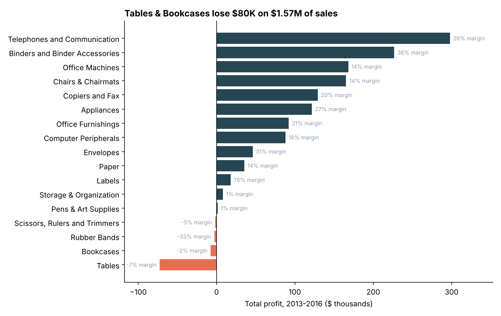
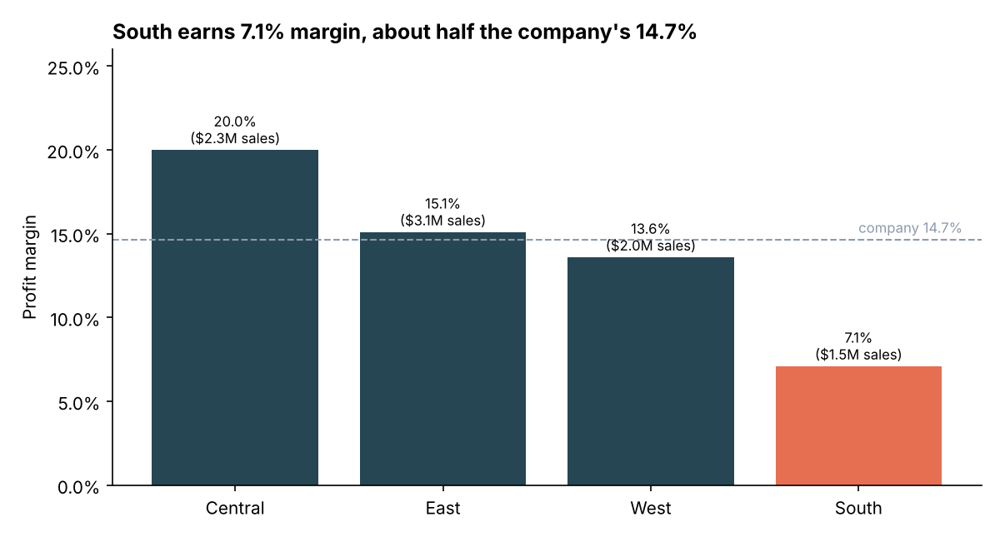
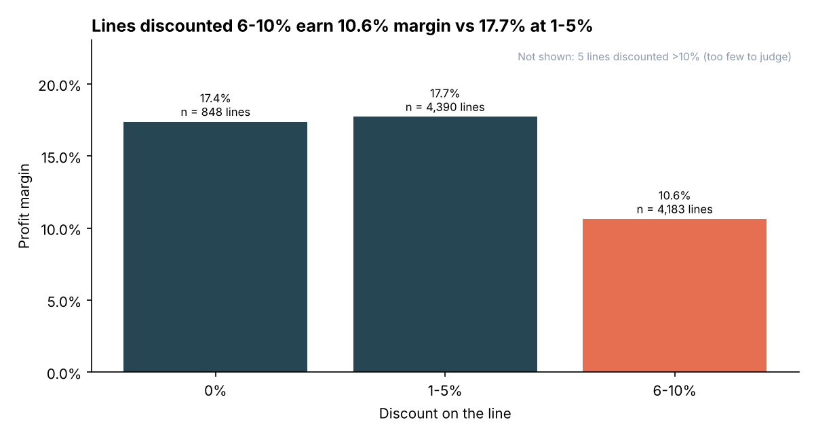
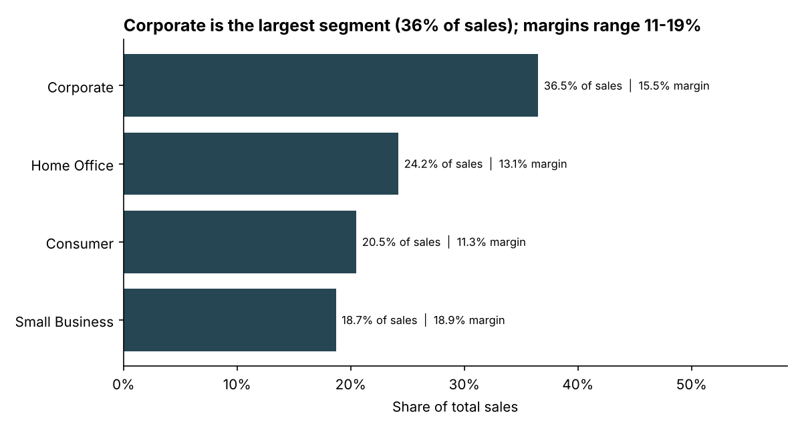
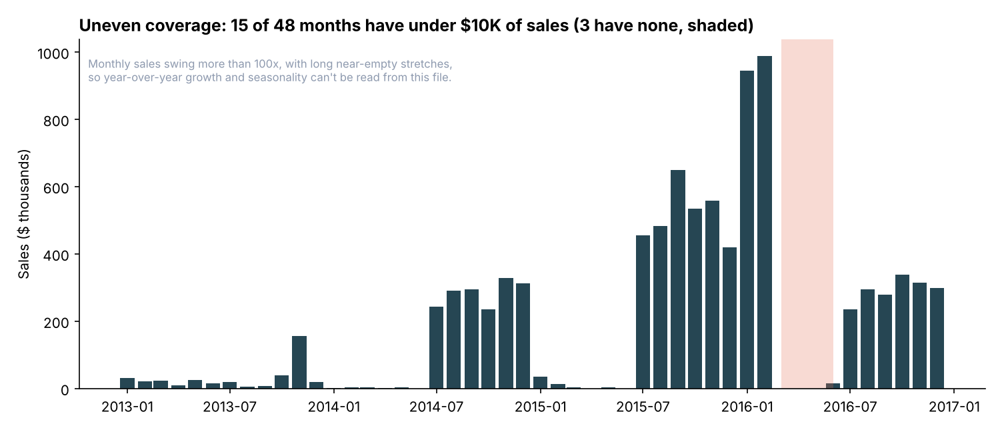

# Superstore Sales & Profitability Analysis

**Business question:** where does this office-supplies retailer make and lose money,
and what should management look at first?

Dataset: the *Superstore* training file that ships with Packt's *Learning Tableau 10*
(9,426 order lines, 2013–2016, 2,703 customers, **fictional company**). See
[Data source and verification](#data-source-and-verification).

## Recommendations

| # | Action | Evidence |
|---|---|---|
| 1 | **Review pricing and freight on Tables (and Bookcases).** | They lose **$80K on $1.57M** of sales. Tables lose money in 3 of 4 regions, and 66% of Tables lines are unprofitable. Their discounts are average (5.1% vs 5.0%), so the problem is price/cost, not discounting. Average shipping cost per line is $57, the highest of any sub-category. |
| 2 | **Investigate the South region.** | South earns a **7.1%** margin vs 14.7% company-wide. If South earned the other regions' margin in each sub-category, profit would be **~$125K** higher. $58K of that gap is in Telephones & Communication alone. |
| 3 | **Put an approval step on discounts above 5%.** | Lines discounted 6–10% earn a **10.6%** margin vs **17.7%** at 1–5% (4,183 vs 4,390 lines, both large samples). If the 6–10% tier earned the 1–5% margin, that is ~$270K more profit. This is an association, not proven causation; see the [correlation-vs-causation follow-up](https://github.com/fritzbriones/superstore-correlation-vs-causation). |
| 4 | **Don't use this file for growth or seasonality claims.** | 15 of 48 months have under $10K of sales and Mar–May 2016 has none, so year-over-year comparisons are an artifact of the sample. |

## Key numbers

- **$8.95M** sales, **$1.31M** profit, **14.7%** margin
- 8,171 orders (Order ID + Order Date), average order **$1,096**
- **48%** of lines lose money, which is very high for a retailer and another sign this is training data
- Segments: Corporate is the largest (36.5% of sales); Small Business is the smallest (18.7%) but has the best margin (18.9%)

## Charts

**Where profit is made and lost**, all 17 sub-categories:


**Regional margin:**


**Discount tiers.** Only tiers with enough lines to judge are shown (5 lines above 10% are excluded):


**Customer segments:**


**Monthly sales coverage.** Why this file can't answer "are we growing?":


## Data audit (all in `kpi.json` → `data_audit`)

| Check | Result | Decision |
|---|---|---|
| Exact duplicates | 0 | Rule kept for reproducibility |
| `Order Priority = "Not Specified"` | 1,881 lines | Converted to missing |
| `Row ID` | Contains dates (e.g. 11/18/1951) in the publisher's own file | Column dropped; not an identifier |
| `Order ID` reused across dates | 1,448 of 6,455 IDs appear on 2+ different order dates (some years apart) | An order is defined as Order ID + Order Date (8,171 orders) |
| Profit > Sales on a line | 367 lines | Kept but flagged here; impossible for real data (margin >100%) |
| Shipped >30 days after order | 419 lines | Kept |
| Months with no orders | 2016-03, 2016-04, 2016-05 | Shown as gaps; no trend claims |

## Limitations

- **Fictional data.** Findings show the method, not facts about a real company.
- **Associations, not causes.** Region, discount and category effects overlap. The follow-up repo tests the discount claim properly.
- Profit figures are taken as given; the 367 lines with profit greater than sales suggest the generator didn't enforce consistency.

## Data source and verification

`raw_superstore.csv` is **byte-for-byte identical** to `Chapter 01/Superstore.csv` in
Packt's official repo [PacktPublishing/Learning-Tableau-10](https://github.com/PacktPublishing/Learning-Tableau-10)
(2,135,360 bytes, 9,426 rows, 25 columns, checked on 2026-11-23).

It is **not** Tableau's built-in *Sample – Superstore*, which has different columns (Segment, Sub-Category, Product ID) and different values. Packt itself tells readers to use its supplied Superstore.csv instead of Tableau's sample because the results differ.

## Reproduce

```bash
pip install -r requirements.txt
python analyze.py
```

Regenerates every chart, table and `kpi.json` from `raw_superstore.csv` (deterministic).

## Files

| File | What it is |
|---|---|
| `analyze.py` | Full pipeline: audit → clean → KPIs → 5 charts |
| `raw_superstore.csv` | Source data (unchanged) |
| `kpi.json` | KPIs + data-audit results |
| `profit_by_category.csv`, `region_performance.csv`, `south_gap_by_category.csv`, `discount_impact.csv`, `segment_performance.csv`, `monthly_trend.csv` | Tables behind each chart |
